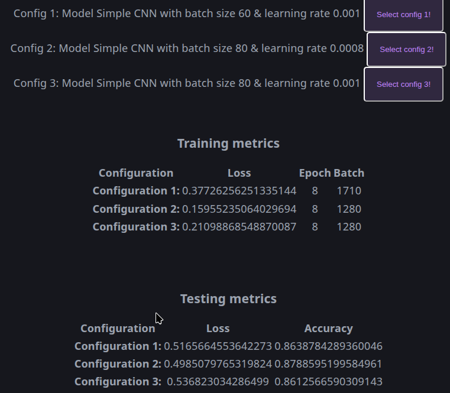
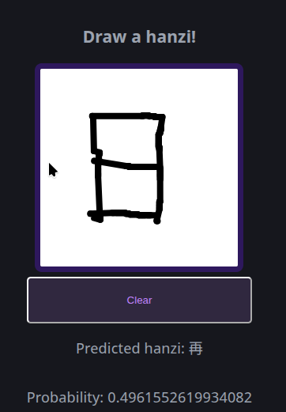
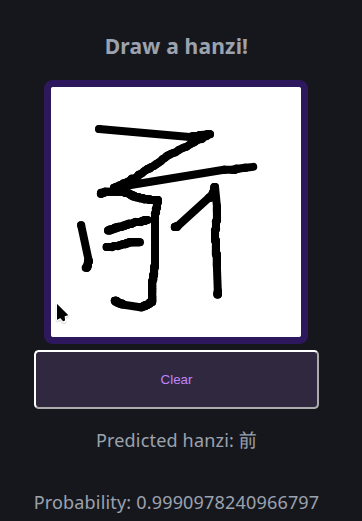
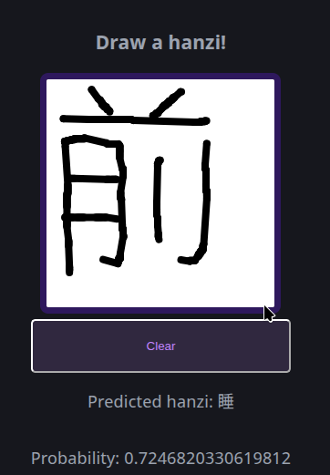
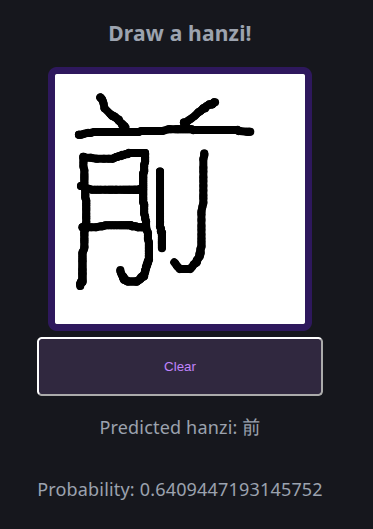
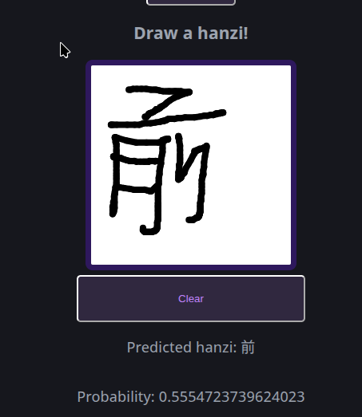
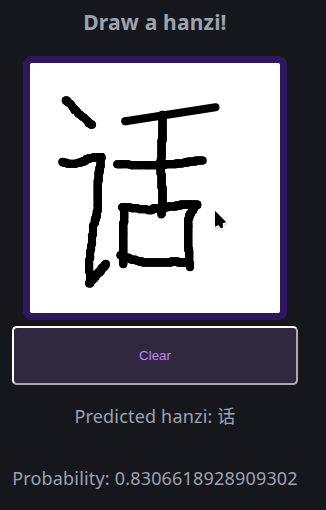

# In-Browser Handwritten Hanzi Recognition
**Kali Ganatsa's project for Neural Networks course for the 8th semester of Informatics@AUTh**

***ΑΕΜ 4636 (pgkana@auth.gr)***

Download the full project including the images by cloning the [github repository](https://github.com/Zalaxci/hanzinception) - currently private.

## Overview

Different neural networks were coded in javascript and trained in the browser to classify handwritten chinese hanzi (汉字) included in the HSK1 exam. A simple CNN with 4 hidden convolutional and 3 pooling layers achieves an accuracy of 84-87%, while a more complex inception-style CNN achieves a higher accuracy of 90% and recognizes hanzi written on the canvas even if they don't correspond to the chinese calligraphic style of the training data. Images of the 178 HSK1 hanzi split into train and test sets is provided by CASIA HWDB and downloaded from [Kaggle](https://www.kaggle.com/datasets/vitaliikyzym/chinese-handwriting-recognition-hsk-1). To enable GPU-accelerated linear algebra and simplify neural network training [Jax.js](https://jax-js.com) was used, while [Svelte](https://svelte.dev), [Vite](https://vite.dev) and [Bun](https://bun.sh) were used as the UI framework, server and javascript runtime as well as package manager respectively. Image data is only downloaded once and then stored in the Origin Private Filesystem (OPFS) and to make training faster, images are stored in main memory and reused from epoch 2, while a custom PNG parser is used for efficient PNG parsing.

## Try it online!!

The website is publically available on Firebase at [https://hanzinception.web.app/](https://hanzinception.web.app/) - originally this was cloudflare but I couldn't upload all the image files so I chose Firebase even though it has a bandwidth limit of 360MB a month so 2 users can try it out at most. Selecting **"load weights"** allows one to try the pre-trained *inception module*, while pressing **"train model"** after the images have been succesfully loaded will train the simpler yet still accurate CNN as a proof-of-concept. This was chosen as the inception module takes too long to train and can lead to crashes, while the simple CNN can achieve a high enough accuracy to recognize some hanzi drawn on the canvas in a few minutes, making it satisfying to train live.

### The website can display training & testing metrics for different configurations, and the user can choose one to use for the canvas


### Simple CNN fails to recognize even basic hanzi if they do not fit into the pattern of chinese calligraphic writing seen in the training data or they are drawn slightly distorted or in a wrong position, likely because it overfits





### Inception CNN gets better results even in harder hanzi and generalizes better





## ...or run with bun

Download bun from [bun.sh](https://bun.sh/) and run ```bun install``` followed by ```bun run dev``` - any other node package manager such as npm or pnpm ought to work too, in a similar fashion.

## Motivation

Hanzi recognition was chosen as a more challenging problem to solve than MNIST (or training on a similarly simple dataset with few classes), for which it would feasible to get good results with a budget graphics card unlike with more complex image recognition tasks. I was also wondering how character recognition works for japanese dictionaries like [Jisho](https://jisho.org) and language learning apps, and if it would be possible to train a machine learning model to achieve as good or better prediction accuracy locally, but there was no complete kanji dataset on kaggle, so handwritten hanzi was used instead, which are similar to japanese kanji.

As tensorflow didn't work on my AMD RX 5500 XT graphics card, and people also mentioned other python libraries not working with older AMD GPUs, I looked for another solution and stumbled upon Jax.js. Jax.js is a port of the Jax python library to javascript that enables GPU-accelerated linear algebra and neural network trainining in-browser, based on WebGPU or WebGL. In retrospect, using a browser based library made loading the data a lot harder, and a lot of time was spent implementing PNG parsing and OPFS storage access, while in the end the neural net uses more memory than expected, and something like PyTorch or Python Jax would likely have worked even on older AMD GPUs (such as the RX 5500 XT). But it still a fun proof of concept for the idea of training and running machine learning models locally in the browser, and Jax.js could make machine learning more accesible if it becomes more efficient and an ecosystem of libraries to deal with machine learning data is developed.

## Architectural overview

To decouple the UI from the logic and data layers, the MVC (Model View Controller) architecture was used, and an OOP (Object Oriented Programming) paradigm was followed. The models folder includes a [PNG Parser](./src/models/PNG.ts) with [tests](./src/models/PNG.test.ts), a [Hanzi Storage class](./src/models/HanziStorage.ts) to simplify downloading files to and opening files from the OPFS and of course the neural network implementations, including a [base Neural Network Model class](./src//models/NeuralNetwork.ts) and [each of the Hanzi Recognizer Models](./src/models/HanziRecognizer.ts). The main UI component is the [Neural Network Training View](./src/views/NNTrainingView.svelte), while the [Image Download View](./src/views/ImageDownloadView.svelte) is shown while the images are downloading (or when checking if they are present every time the website is launched) and the [Hanzi Drawing View](./src/views/HanziDrawingView.svelte) enables real time character recognition while the user draws on a canvas, in the spirit of [Jax's mnist training example](https://jax-js.com/mnist). The [Hanzi Recognition Trainer](./src/controllers/HanziRecognitionTrainer.ts) is the glue between the UI and the models and allows training multiple combinations of models, batch sizes and learning rates

## Neural network architecture

3 different neural networks are implemented in [Hanzi Recognizer](./src/models/HanziRecognizer.ts): An Multilayer Perceptron with 5 hidden layers, a Convolutional Neural Network with 7 hidden layers (4 convolutions / 3 pooling) and a fully connected output layer, and a GoogLeNet-style CNN with 8 hidden layers, 2 of which correspond to an "inception" module to calculate many convolutions in parallel. As the images were of different sizes they were resized with image magick to 50x50 (see: [resize.sh](resize.sh)), to make for a 2500-length input vector per training or testing example.

Firstly, a **Multilayer Perceptron** or "vanilla" neural net is implemented under class "HanziRecognizerMLP". **5 hidden layers** were chosen as increasing the number of layers led to diminishing returns, with the first hidden layer having 500 neurons, as any more seemed to decrease accuracy and increase loss, and the following layers having progressively less **neurons: [500, 400, 300, 200, 200, 178]**. **ReLU** was used as the activation function, as it is commonly used in modern deep neural networks for object recognition, and softplus that was tested as an alternative seems to lead to computation errors as the loss eventually becomes NaN. Unfortunately test loss keeps oscilating and never converging to zero unless filtered PNG data is used instead of actual pixel values, in which case test accuracy is still below 50%, and real-time drawn character recognition would require a PNG encoder.

A **convolutional neural net (CNN)** with **4 hidden convolution layers and 3 pooling layers** to shrink the image until the number of pixels is one achieves an **accuracy of 84-87%** depending on hyperparameters and initial (random) wegihts after training for 30 minutes for 8 epochs. Each convolution has a size of **3x3** and increases the **number of channels** to **16, 64, 128 and 256** respectively, while the pixel count is reduced as padding is not used, due to the outer pixels being typically blank in character recognition datasets. Between convolutions, **max pooling of 2x2, 2x2 and 3x3** respectively is used to further reduce the number of pixels until after the final 3x3 convolution a stack of single pixels for each of the 256 channels is obtained - this is mapped to the outputs via **a fully connected layer**, and log softmax is applied. Adding another 1 or 2 hidden fully connected layers didn't seem to improve accuracy, and neither did leaving PNG filtering on instead of training the neural net in the actual pixel data. But unfortunately the model's ability to recognize hanzi written in the canvas is really poor, failing to recognize most hanzi I wrote.

Finally, **"HanziRecognizerInception"** is inspired by GoogLeNet (or Inception v1) which won the 2014 ImageNet Large Scale Visual Recognition challenge, uses the following architecture:
- **5x5 convolution** without padding, to reduce pixel count to 46x46, and increase channel count to 64
- **2x2 max pooling** to reduce pixel count to 23x23
- **An inception-like layer**, which applies some 1x1 convolutions each followed by 3x3 max pooling with stride 1, 3x3 convolution and 5x5 in parallel, with the channels stacked to get **224 output channels**. Pixel count is reduced to 21x21.
- **3x3 max pooling with stride 2** to reduce pixel count to 10x10
- **An inception-like layer** which keeps the channel count as 224 but decreases pixel count to 8x8
- **A 1x1 convolution** to compress channel space to just 100 channels
- **4x4 average pooling** to compress pixel count to 2x2
- **A fully connected layer** to map each of the resulting 400 values to the outputs with logsoftmax applied

This took many hours to train and it crashed 3 times in total, 2 because all of the test data was being loaded in GPU memory, thus filling up VRAM until the AMDGPU driver crashed and I was logged out, and 1 due to cloudflare also lagging as I tried to upload the images to Pages but this large a number of files was not supported. Hence why I didn't try tuning the hyperparameters which would've yielded better results. Nonetheless, this final model doesn't just achieve better accuracy but actually recognizes almost all hanzi I wrote, which would make it genuinely useful to search and learn hanzi should I decide to learn chinese.

### Inception module architecture

The inception module's architecture is built upon 2 ideas: Firstly, that the model should "choose" itself which convolution size, or which combination of different convolution sizes is necessary to recognize specific features in the dataset. For instance, when recognizing an eye, maybe a 3x3 convolution is needed to recognize the eye's edge, a 5x5 to look across different parts of the eye, while an 1x1 convolution followed by max pooling might signify the brigtest color in the region. Similarly, a 3x3 convolution might recognize the direction of a stroke while a 5x5 convolution might recognize curvature or where multiple strokes meet. Secondly, the model should compress its representation of different features by reducing the number of channels. Following the previous example, if certain channels are responsible for recongizing a dog's eye, a human's eye, a cat's eye and so on, perhaps for different facial features then the model might compress its representation space so that only 1 neuron corresponds to an eye and 1 to whether the image depicts a human. This is done by applying a 1x1 convolution, i.e. linear transformation for the vector of channel values of each pixel. The ```calculateInception``` specifically calculates 3 routes (for GoogLeNet this was 4 but I kept things simple to get a model that fits in my GPU):

1. 3x3 max pooling with stride 1, followed by 1x1 convolution
2. 1x1 convolution (channel reduction) followed by 3x3 convolution
3. 1x1 convolution (channel reduction) followed by a padded 5x5 convolution

The final model, ```HanziRecognizerInception``` uses 2 inception modules:

1. The first module has **64 channels as input**, and **outputs 224 channels**: **128 3x3 convolution channels** (as 3x3 convolution tends to be more common more were chosen), **64 max pooling channels** and **32 5x5 convolution channels**. The 1x1 convolution corresponding to the first two doesn't compress channel space for each pixel, keeping the number of channels to 64, but for the third it compresses the input to 16 channels before applying the 5x5 convolution.
2. The second module has **224 channels as input**, and **outputs 224 channels** in a similar fashion: 128 3x3 convolution channels, 64 max pooling channels and 32 5x5 convolution channels. However, this time the channel space for each pixel is compressed to **64 (after applying max pooling), 64 (before 3x3 convolution) and 16 (before 5x5 convolution)**

### Data loading optimizations

Unfortunately, while coding an example neural network to recognize MNIST digits, similar to [the example site provided by Jax.js](https://jax-js.com/mnist), there was a big roadblock in training a more complex neural network on real world data: Downloading and parsing PNG's in the browser is painfully slow (even from localhost!), and even one batch might take seconds to just download and parse. To fix this the following optimizations were made:
1) Use the Origin Private File System (OPFS) and code a loading screen in ImageDownloadView.svelte to show while the files are downloading. To achieve faster download speeds, requests are batched with a size of 200.
2) Modify code of ["png-js"](https://github.com/foliojs/png.js/tree/master), to achieve fast PNG parsing. The biggest improvement is using the browser's DecompressionStream API instead of unzlib to decompress the image data (compressed with LZSS and huffman encoding) which speeds up loading a PNG from >20ms to 1ms-2ms in my testing. I also removed parts that read an image's metadata as that is unnecesary for our purposes and improved memory efficiency.
3) Training images are only loaded in the first epoch and then kept in main memory - originally that was GPU memory but larger models wouldn't allow the data to fit in GPU memory as well.
4) Use Promise.all in the training function to wait for image data simultaneously with waiting for the model's weights to update. Since the latter task is delegated by Jax.js to the GPU using WebGPU, the two can happen in parallel, even if the JS engine is not inherently parallel and Promise.all is normally used to synchronize concurrent programs. Still, even with this and data stored in main memory, GPU usage drops to 0 momentarily while data is loading, leading to wasted GPU cycles, but with these optimization the GPU can be utilized most of the time instead of mostly staying idle.
